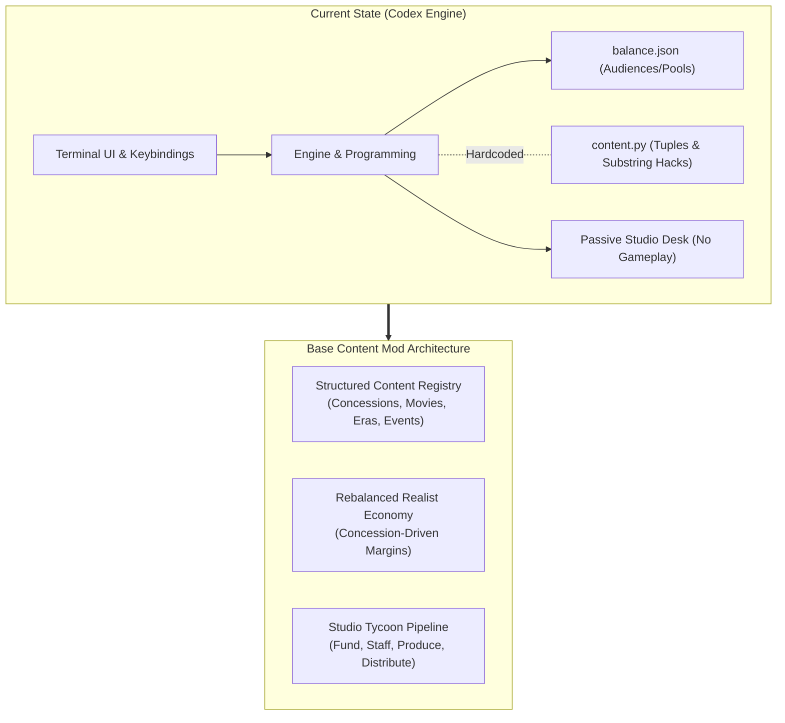
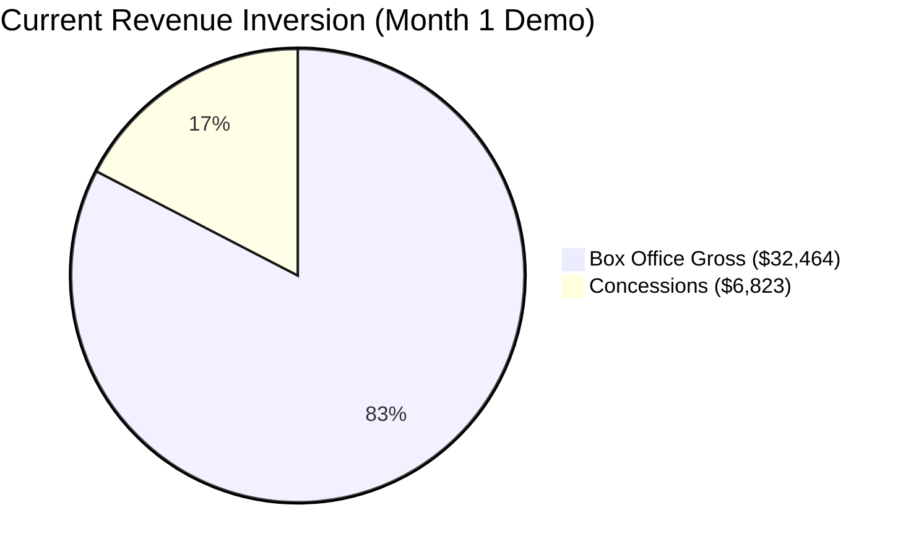
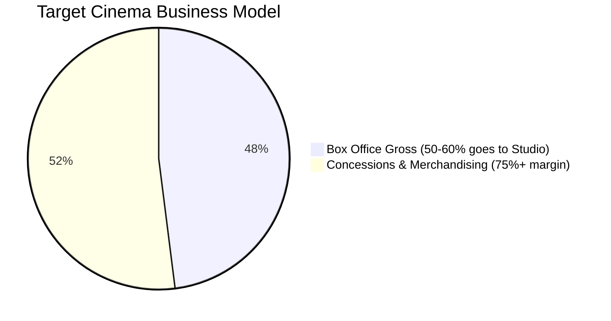
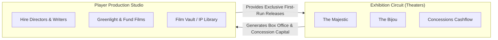
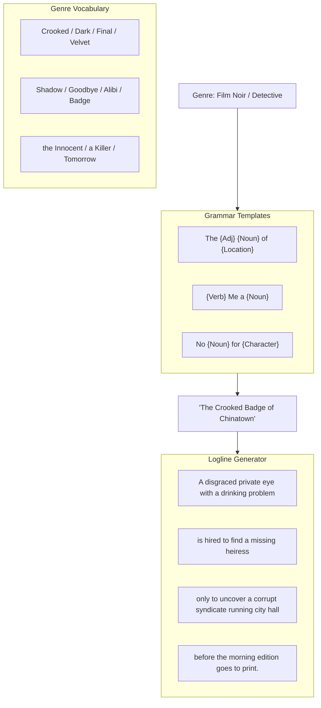

# Silver Screen: Comprehensive Project Review & Base Content Mod Design

**Date:** September 22, 2026  
**Author:** Gemini (Pair Programmer)  
**Status:** Core engine architecture evaluated ("bones are good"); major economic rebalance, bug fixes, and content overhaul designed. Ready for user feedback and next steps.

---

## Executive Summary & Verdict: Is It Good to Go?

> [!IMPORTANT]
> **Verdict: The bones are solid, and the project is ready to advance to the Base Content Mod design and implementation phase.**
> 
> Codex built a sturdy, functional foundation:
> 1. Deterministic monthly engine with seeded PRNG (`random.Random(f"{seed}:{counter}")`).
> 2. Atomic, versioned JSON serialization and state validation (`persistence.py`).
> 3. Clean single-key raw terminal UI without external library dependencies (`terminal.py`, `cli.py`).
> 4. Passing test suite (65 tests across UI, concessions, weekly programming, and save compatibility).
> 
> However, as noted in the prompt, **the numbers are completely broken, the content is placeholder and repetitive, and key architectural shortcuts (like substring-matching for game logic) must be refactored into a real data-driven content system.**



---

## 1. Code Review & Bugs Analysis

Despite 65 passing tests, several architectural bugs, edge cases, and brittle implementations exist in the codebase:

### Bug 1: Sequential Weekday Market Cap Exhaustion
* **Location:** [engine.py](cinema_tycoon/engine.py#L282-L305)
* **Problem:** The simulation calculates monthly market size (`city.population * 0.30 / local_count`) and iterates through rooms and weekdays sequentially from Monday (0) to Sunday (6):
  ```python
  people = min(int(room.seats * weekday_counts[weekday] * clamp(occupancy, 0, 0.95)
                   * staffing["coverage"]), max(0, monthly_market - audience))
  audience += people
  ```
  If a theater runs busy programs earlier in the week or across multiple screens, `audience` hits `monthly_market` by Thursday. When that happens, `monthly_market - audience` becomes `0`, resulting in **0 admissions on Friday, Saturday, and Sunday**—completely erasing peak weekend turnout! Furthermore, Screen 1 cannibalizes Screen 2 before Screen 2 is even evaluated.
* **Fix:** Distribute the market pool proportionally or calculate attendance per daypart/weekday based on demand share rather than a greedy sequential subtraction.

### Bug 2: Substring Matching on Display Names for Gameplay Mechanics
* **Location:** [concessions.py](cinema_tycoon/concessions.py#L13-L18), [concessions.py](cinema_tycoon/concessions.py#L281-L286), [engine.py](cinema_tycoon/engine.py#L109-L117)
* **Problem:** Codex noted in [NAMING_PROPOSAL.md](NAMING_PROPOSAL.md) that deriving recipe identity from substrings of generated names was dangerous, yet implemented exactly that:
  ```python
  # concessions.py L16
  for ingredient, label in (("Dairy butter", "Buttered popcorn"), ...):
      if ingredient in name: return label

  # concessions.py L282
  if "Dairy butter" in product.name: rate = 0.20
  elif "Butter-style spread" in product.name: rate = 0.08
  ```
  If any mod renames "Dairy butter" to "Fresh Creamery Butter" or provides localized names, spoilage silently reverts to 2% and recipes fail to detect butter.
* **Fix:** Add structured attribute fields on `Product` (e.g., `ingredient_type: str`, `spoilage_rate: float`, `retail_category: str`).

### Bug 3: The "Raw Ingredient at the Counter" Disconnect
* **Location:** [concessions.py](cinema_tycoon/concessions.py#L273-L276), [cli.py](cinema_tycoon/cli.py), [concessions_ui.py](cinema_tycoon/concessions_ui.py)
* **Problem:** When customers buy popcorn or fountain soda, the receipt and sales reports display:
  `Velvet Popping kernels: $5.42 · demand 916 · sold 800 · earned $4,336.00`  
  `Moonlight Cola syrup: $4.00 · demand 1171 · sold 255 · earned $1,020.00`
  Customers are literally purchasing raw kernels and unmixed fountain syrup by the name of the wholesale supplier!
* **Fix:** Separate the wholesale supply item from the customer-facing retail item ("Fresh Buttered Popcorn", "Fountain Cola").

### Bug 4: Dead / Inert Code — `Film.repeats`
* **Location:** [models.py](cinema_tycoon/models.py#L34-L37), [tests/test_game.py](tests/test_game.py#L62-L69)
* **Problem:** In [Project Intro Prompt](prompts/Project%20Intro%20Prompt.md), the user specified that short films (e.g. 20 min in nickelodeon style) loop multiple times per hour. Codex added `repeats = max(1, 60 // minutes)`, but it is never referenced anywhere in `engine.py`. A unit test was even written asserting that a 20-minute movie yields identical admissions to a 60-minute movie!
* **Fix:** Implement turnover multiplier or nickelodeon program bills where short loops cycle more attendees or allow mixed shorts programming.

### Bug 5: Day-Reset Repeat Penalty Bug
* **Location:** [engine.py](cinema_tycoon/engine.py)
* **Problem:** In `engine.py`, `uses = {}` is reset inside the `for weekday in sorted(room.weekly.items()):` loop.
  Screening a movie twice on Monday applies a 0.86 penalty to the second showing. But running the same movie once every day Monday through Sunday applies **zero repeat penalty**, despite audience fatigue.
* **Fix:** Track title screenings across the month and week to calculate true audience fatigue.

### Bug 6: Extreme Generator Bottleneck & Collisions
* **Location:** [engine.py](cinema_tycoon/engine.py#L136-L149)
* **Problem:** Movie titles are composed of 7 prefixes and 8 suffixes (only 56 possible titles!). Within 10 months, collisions occur, appending `— No. 42`. Plots have only 5 protagonists and 4 conflicts (20 total combinations).

### Bug 7: Two-Turn Event System Dead-End
* **Location:** [content.py](cinema_tycoon/content.py)
* **Problem:** `TIMELINE = ((1, "festival"), (4, "festival_return"))`. After month 4, the event system is 100% inert for the rest of the game.

---

## 2. Game Design & Economic Balance ("The Numbers Are Wrong")

Running the engine through `--demo 3` reveals severe balance distortions:

| Metric | Current Code (Month 1) | Real-World / Tycoon Reality | Problem |
| :--- | :--- | :--- | :--- |
| **Net Profit** | +$18,507 / month | -$1,500 to +$2,500 | Hyper-inflation; double initial cash in 3 months with zero effort. |
| **Admissions** | 4,058 admissions / 80 seats | ~1,200 – 1,800 admissions | Single screen operates at unrealistic ~70% capacity 12 hrs/day. |
| **Revenue Share** | Tickets: $32,464 (83%)<br/>Concessions: $6,823 (17%) | Tickets: ~40-50%<br/>Concessions: ~50-60% | Cinema business model inverted! Real theaters make profit on concessions. |
| **License Fees** | ~$210/mo flat + 22% royalty | Variable guarantee vs 50-65% gross split | Studios take only 22% cut; real film distributors demand 50% to 70% in opening weeks. |
| **Overhead** | Flat magic formula (~$9,900) | Itemized transparent costs (rent, power, film delivery, wages) | No player agency to cut utilities, renegotiate rent, or optimize operations. |





### Key Economic Fixes for the Base Content Mod:
1. **Distributor Split Realism:** Increase studio box office royalty from 22% to 45%–60% for first-run studio films, with indie films offering cheaper licensing (25%–35%) or flat upfront rentals.
2. **Concessions as Profit Center:** Increase concession margins and attach items to theater attendance cohorts (e.g., family matinees buy heavy popcorn/candy; late night horror crowds buy soda/snacks).
3. **Pacing & Capital Sinks:** Adjust starting capital, theater property costs, and renovation costs so expanding to a second theater feels like a major strategic triumph rather than an automatic purchase in month 2.

---

## 3. Evaluation of Codex's Prior Work Across the Prompts

| Prompt Document | Requested Objectives | What Codex Did Well | What Was Suboptimal / Left Incomplete |
| :--- | :--- | :--- | :--- |
| **`Project Intro Prompt`** | Console tycoon, monthly turns, procgen concessions (5 flavors), procgen movies with hidden scores & variables, procgen studios with directors, 1-hr slots, nickelodeon shorts, US map, upgrades, events. | Built core monthly loop, deterministic PRNG, single-screen schedule, 5-flavor vector matching with cities. | Studios became read-only stat blocks with no player agency. Short looping was stubbed but made inert (`Film.repeats`). Only 2 hardcoded events. Map simplified to simple city list. |
| **`Next Prompt`** | 12h AM/PM clock default, automatic gap filling by pool, 24h slots, weekday vs weekend weighting, audience dayparts, multi-room theaters, staff wages. | Added `balance.json` modding file, 7-day weekly schedule, dayparts & audiences, multi-room support, staff payroll. | Sequential market cap bug introduced. Repetition penalty reset per day. Pool autofill purely uniform random without schedule cohesion. |
| **`UI Refactor Prompt`** | Screen clearing on navigate, list all options without blind IDs, rank movies by budget, corporate names for concessions. | Implemented screen clearing, paged `select()` helper with 1–9 keys, sorted film catalogue, corporate producer dict. | Movie synopses and titles left with only a handful of hardcoded templates. Concession names combined corporate brand + raw ingredient ("Velvet Popping kernels"). |
| **`Movie Add Refactor`** | Zero typed commands (single keypress flow: button for movie, button for slot, Y/N conflict prompt), popper input/yield mechanics, soda tank loading, butter vs oil sourcing, case vs merchandiser. | Excellent single-key booking workflow, strict Y/N conflict resolution, popcorn recipe system, soda fountain syrup yield. | Substring matching used for all recipe labels and spoilage rates. Vendor cases hardcoded. Customer-facing item names not implemented. |
| **`Options Refactor`** | Options list menu, random seed option. | Clean options menu, persistent `options.json`, seed and time format persistence. | Minor: changing seed only applies to new games, but UI doesn't visually remind the player in the main menu until they enter options. |
| **`NAMING_PROPOSAL.md`** | Proposal on customer-facing names vs supplier names, grammatical title generation, logline vs viewing notes structure. | Well-reasoned document outlining structural separation. | **Never implemented in code!** Remained a markdown proposal while code continued using raw strings. |

---

## 4. The Studio Tycoon vs. Cinema Tycoon Vision

The user stated in [Gemini Intro](prompts/Gemini%20Intro.md):
> *"Game is a movie studio tycoon. The numbers are wrong, the content is wrong, and we need to change it, but the bones are right."*

And in [Project Intro Prompt](prompts/Project%20Intro%20Prompt.md):
> *"Eventually you can fund a production company of your own, and manage the staff directly, so keep that in mind."*

Codex built Silver Screen solely from the perspective of a **theater exhibitor**. The player manages theaters, rooms, popcorn machines, and schedules. The production companies are merely distant third parties in an "Industry Desk" submenu.

### The Unified Tycoon Loop (The Golden Age Hollywood Model):
In classic cinema history (the Studio System era, 1920s–1950s Paramount/MGM/RKO model), **Studios owned their own theater chains to guarantee distribution for their pictures**.



1. **Early Game:** You operate theaters, master the box office, optimize concessions, and build reliable capital.
2. **Mid Game:** You fund your own boutique production company or acquire an ailing studio. You hire directors, greenlight scripts, set budgets, and produce films.
3. **Late Game:** You run a vertically integrated movie empire! Your theaters premiere your own blockbuster or auteur films (keeping 100% of the box office royalty and license fee), while licensing your catalog to rival circuits.

---

## 5. Base Content Mod Architecture & Design Specification

To fix the content once and for all, we must replace hardcoded Python tuples with a clean, extensible **Content Registry System**.

### 5.1 Architecture Overview
Instead of scattering text and arrays across `content.py` and `engine.py`, content will be structured into modular data definitions:

```text
cinema_tycoon/
├── content/
│   ├── __init__.py           # Loader & ContentRegistry
│   ├── concessions.json      # Structured snacks, suppliers, recipes, toppings
│   ├── films.json            # Genre vocabularies, title grammars, logline components
│   ├── eras.json             # Era definitions, tech unlocks, historical constraints
│   ├── events.json           # Branching event trees & monthly event deck
│   └── equipment.json        # Projectors, sound, poppers, fountains, merchandisers
```

### 5.2 Structured Concession Schema
Separating **Wholesale Ingredient/Product** from **Retail Concession Offer**:

```json
{
  "suppliers": [
    { "id": "fairground", "name": "Fairground Foods", "reputation": 65, "specialty": "kernels" },
    { "id": "velvet", "name": "Velvet Confectionery Co.", "reputation": 85, "specialty": "chocolate" }
  ],
  "ingredients": [
    {
      "id": "yellow_butterfly_kernels",
      "name": "Yellow Butterfly Corn",
      "supplier_id": "fairground",
      "category": "kernels",
      "wholesale_cost": 8.50,
      "unit": "bag",
      "base_yield": 24,
      "spoilage_rate": 0.02,
      "flavors": { "savory": 70, "salty": 60, "bitter": 0, "sweet": 5, "sour": 0 }
    },
    {
      "id": "dairy_butter",
      "name": "Wisconsin Dairy Cream Butter",
      "supplier_id": "fairground",
      "category": "topping",
      "wholesale_cost": 12.00,
      "unit": "tub",
      "base_yield": 30,
      "spoilage_rate": 0.20,
      "flavors": { "savory": 95, "salty": 55, "bitter": 0, "sweet": 5, "sour": 0 }
    }
  ],
  "retail_offers": [
    {
      "id": "buttered_popcorn",
      "display_name": "Hot Buttered Popcorn",
      "category": "popcorn",
      "required_category": "kernels",
      "required_topping": "dairy_butter",
      "default_retail_price": 5.50,
      "consumable_cost": 0.22
    }
  ]
}
```

### 5.3 Grammatical Film Generation Engine
Solving the 56-title limit and generic 20-plot problem with genre-aware grammars:



* **Title Combinations:** Over 10,000+ genre-tailored titles with correct grammatical articles ("The", "A", proper nouns).
* **Rich Synopses:** Four-part narrative logs (Protagonist, Inciting Incident, Complication, Stakes).
* **Employee Screeners:** Nuanced subjective notes reflecting acting quality, pacing, cinematography, and quirks without revealing hidden numeric stats.

### 5.4 Era Progression (Historical Immersion)

| Era | Timeline | Key Characteristics & Mechanics | Unlocked Tech & Products |
| :--- | :--- | :--- | :--- |
| **Silent & Nickelodeons** | 1895–1927 | Short films (10-30 min) looping continuously. Live piano / organ costs. High turnover, low ticket price ($0.05–$0.15). | Hand-cranked projectors, penny candies, nickelodeon looping. |
| **Golden Age / Talkies** | 1928–1948 | Sound pictures revolutionize the industry. Feature films (75-105 min). Popcorn machines introduced to survive the Depression. | Vitaphone sound, kettle poppers, soda fountains. |
| **Widescreen & Spectacle** | 1950–1969 | Fight against television. Technicolor, CinemaScope, stereo sound. Drive-in theaters, expansive snack counters. | Widescreen lenses, butter dispensers, candy merchandising cases. |
| **New Hollywood & Blockbusters**| 1970–1999 | Summer blockbuster era (*Jaws*, *Star Wars*). Multiplexes with 4–12 screens. Massive midnight and opening weekend queues. | Automated platters, Dolby stereo, computerized ticketing. |
| **Digital Cinema** | 2000+ | Digital projection, luxury recliners, craft concessions, premium large formats. | 4K digital projectors, heated luxury recliners, self-serve dispensers. |

---

## 6. Suggestions & Immediate Next Steps

### Phase 1: Engine Bug Fixes & Refactoring (Immediate)
1. **Fix Market Saturation:** Remove sequential day iteration; allocate city audience proportionally across schedule slots.
2. **Clean Substring Checks:** Refactor `concessions.py` to use explicit fields on `Product` for spoilage and recipes.
3. **Fix Retail Offer Naming:** Update concession sales reports and menus so customers buy "Buttered Popcorn" and "Fountain Cola", not "Popping kernels" and "Cola syrup".
4. **Fix Day Repeat Penalty:** Track movie uses across the weekly program rather than clearing `uses = {}` each day.

### Phase 2: Base Content Mod Implementation
1. **Extract Content to JSON/Registry:** Create `concessions.json`, `films.json`, `eras.json`, and `events.json`.
2. **Massive Grammar Expansion:** Build full vocabulary sets for all 6 genres and 18 subgenres.
3. **Event Deck Expansion:** Expand from 2 hardcoded events to 25+ dynamic, condition-triggered industry events.

### Phase 3: Studio Tycoon Prototype
1. **Studio Founding:** Add ability in "Industry Desk" to fund your own production company with theater profits.
2. **Production Pipeline:** Hire a director/cast, pick script/genre, set budget, and release the film to your own theaters.

---

> [!TIP]
> **Summary Recommendation for the User:**  
> The codebase is solid, robustly written, and completely ready for the Base Content Mod overhaul. Let me know if you would like me to begin fixing the engine bugs and implementing the data-driven content mod architecture!
